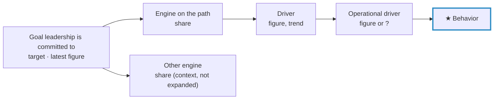

# Output

One markdown note per account: `[Company] - driver tree.md`. Sections in this order; Quick mode drops the ones marked *Deep*.

````markdown
---
company: [Company]
mode: quick | deep | practice
date: YYYY-MM-DD
seller: [from profile]
context: [the user's starting context, in a few words, or none]
---
# [Company] - driver tree

**Story in one line:** [what is happening to this business, plain words]

**Contact first:** [role] (why: owns [behavior], under pressure from [pressure])

**Your starting point:** [the user's context] → [held up / sharpened / contradicted]: [one line on why]. *(Only if the user gave context.)*

## Tree

⚠ = pressure · ★ = owned by the role to contact · ? = not public

## Why this path
[owned behavior] → [driver] → … → [engine] → [outcome]. One line per link: **how** the child produces the parent (sum, product, rate, direct consequence), then the evidence.

## Point of view
[2–3 sentences about their business]

## Cold questions
For a cold call, LinkedIn or email: short, one hypothesis, answerable in a sentence.
1. [question] *(node: …)*

## Discovery questions  *(Deep)*
For a booked first call: open-ended, for the `?` figures, how they measure the driver, who owns what, what they've tried.
- [question] *(node: …)*

## Roles and what they own  *(Deep)*
| Role | Owns (behaviors) | Pressure on them | Evidence |

## Where we fit (private)
- [capability] → [behavior] → [driver] (proof: …)

**Against what they have:** [their tool or vendor] vs [the seller], point by point (sources, where available, who and what can use it, quality, analytics) → replacement / complement / layer underneath / different job.

**Angle of attack:** [entry use case or deployment] for [role], framed as [approach]. Expect: [main objection] → [answer].

## Alternative paths  *(Deep)*
| Path | Input it moves | Time to show | Cost | Risk | Their story |

## Evidence
| Node | Figure or fact | Source | Source date | Type |
| --- | --- | --- | --- | --- |
| E1 | ... | [name](url) | 2026-08 | stated |

## Practice  *(Practice mode only)*
Their tree, the comparison (agree / missing / different / overreach / broken link), takeaway.
````

## Mermaid rules
- `graph LR`, outcome on the left. Node ids short (O, E1, D1a, B1a).
- Labels in double quotes; `<br/>` for line breaks; max 3 short lines per node. No double quotes inside labels (use single quotes).
- Pressure goes inside the node it hits, as a last line: `⚠ guidance cut Q3`. Add `class X pressure` to that node.
- Owned behaviors start with `★` and get `class X owned`.
- Unknown figures: `?`.
- **≤ ~15 nodes.** Engines off the path are single nodes, not expanded. If the tree is bigger, it's a list, not a picture: cut the drivers that no path runs through.
- Never put a product name in a node: not the seller's, not a competitor's, not the target's own tool.
