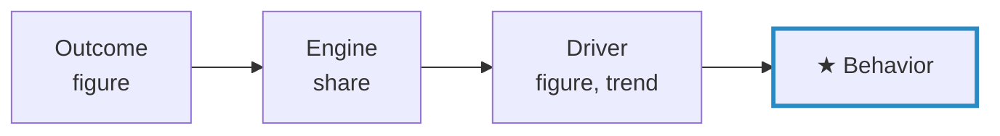

# Output

One markdown note per account: `[Company] - driver tree.md`. Sections in this order; Quick mode drops the ones marked *Deep*.

````markdown
---
company: [Company]
mode: quick | deep | practice
date: YYYY-MM-DD
seller: [from profile]
---
# [Company] - driver tree

**Story in one line:** [what is happening to this business, plain words]

**Contact first:** [role] (why: owns [behavior], under pressure from [pressure])

## Tree

⚠ = pressure · ★ = owned by the role to contact · ? = not public

## Why this path
[owned behavior] → [driver] → [engine] → [outcome], one sentence per link, citing the evidence.

## Point of view
[2–3 sentences about their business]

## Opening questions
1. [question] *(node: …)*

## Roles and what they own  *(Deep)*
| Role | Owns (behaviors) | Pressure on them | Evidence |

## Where we fit (private)
- [capability] → [behavior] → [driver] (proof: …)

## Alternative paths  *(Deep)*
| Path | Input it moves | Time to show | Cost | Risk | Their story |

## Unknowns → discovery questions
- [? node]: [what to ask]

## Evidence
| Node | Figure or fact | Source | Source date | Type |
| --- | --- | --- | --- | --- |
| E1 | ... | [name](url) | 2026-08 | stated |

## Practice  *(Practice mode only)*
Their tree, the comparison (agree / missing / different / overreach), takeaway.
````

## Mermaid rules
- `graph LR`, outcome on the left. Node ids short (O, E1, D1a, B1a).
- Labels in double quotes; `<br/>` for line breaks; max 3 short lines per node. No double quotes inside labels (use single quotes).
- Pressure goes inside the node it hits, as a last line: `⚠ guidance cut Q3`. Add `class X pressure` to that node.
- Owned behaviors start with `★` and get `class X owned`.
- Unknown figures: `?`.
- ≤ ~20 nodes. If it's bigger, the tree is a list, not a picture: cut the drivers that no behavior hangs from.
- Never put the seller's or any product name in a node.
